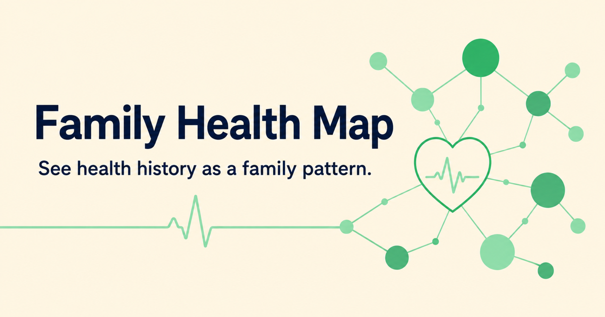
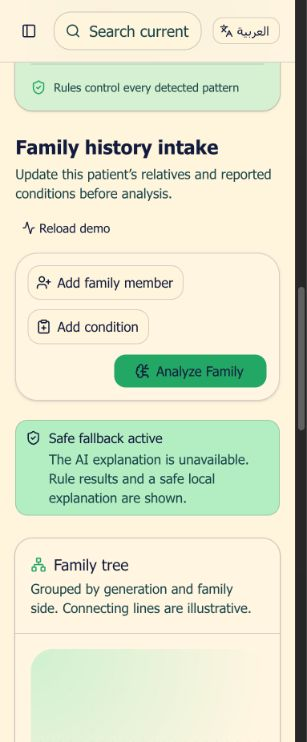
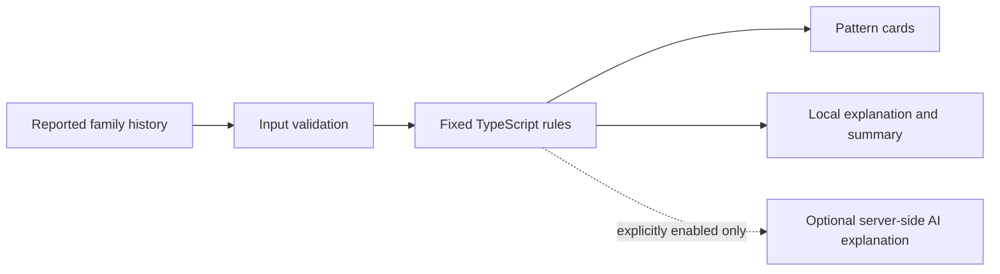

<p align="center"></p>
<h1 align="center">Family Health Map</h1>
<p align="center">A bilingual family health history demo with an interactive family tree and transparent pattern rules.</p>
<p align="center"><strong>TypeScript · React · Next.js · React Flow · Tailwind CSS · English / العربية</strong></p>

Family Health Map organizes reported conditions across relatives and generations. It uses fixed TypeScript rules to highlight repeated conditions, patterns across generations, and entries below two configured age thresholds. A local explanation and a summary help present those records clearly.

**Status:** working portfolio demo with fictional data. There is no login, patient database integration, or clinical validation. AI explanations are optional and disabled by default. The complete demo works without an API key, database, or paid service.



<details>
<summary>View actual mobile dashboard screenshots in English and Arabic</summary>

<p align="center">


</p>

</details>

## Try it locally

Requires Node.js 22.13 or newer and npm. Node.js 24 was used for local verification.

```bash
npm ci
npm run dev:next
```

Open [localhost:3000](http://localhost:3000). No environment file is required for the demo.

1. Review the fictional demo family or select **New patient** to start a temporary record.
2. Add relatives, generation, family side, and reported conditions.
3. Select **Analyze Family** to run the fixed rules.
4. Review the interactive tree, pattern cards, and summary.
5. Switch between English and Arabic. Arabic uses right-to-left layout.

New entries stay in the current page's React state. Refreshing the page restores the fictional demo. **Use fictional data only.** The app is not a secure patient-record system.

## Features

- English and Arabic UI with right-to-left support.
- Interactive family visualization with zoom and pan.
- Temporary patient, family member, and condition forms.
- Deterministic pattern detection that excludes non-blood relatives.
- Duplicate-condition handling so one person is not counted as two relatives.
- Local explanations and a copyable summary without external credentials.
- Validated analysis API and browser-side fallback if the service is unavailable.
- Unit/API tests, type checks, linting, and two build targets.

## How analysis works



| Rule | Behavior |
| --- | --- |
| Repeated condition | Same normalized condition in at least two distinct blood-relative records |
| Across generations | Same condition in blood-relative records from at least two generations |
| Configured age threshold | Breast cancer or colorectal cancer reported below age 50 |

The age cutoffs are prototype configuration values, **not validated clinical screening recommendations**. Condition matching trims whitespace and ignores case. It does not translate Arabic condition input or merge medical synonyms. The language switch translates supported display labels, not arbitrary medical terms.

AI never selects or changes the patterns. If enabled separately, it only receives rule results and limited relevant history to generate wording. The optional AI path has not been live-tested in this release. Generated wording still requires human review.

## Verify

```bash
npm run typecheck
npm test
npm run lint
npm run build:vercel
npm run build
```

`typecheck` uses a dedicated config so generated files from the two build tools do not conflict. `build:vercel` creates a standard Next.js production build. `build` creates the alternative Vinext/Cloudflare Worker build.

## Run a production build locally

For the standard Next.js target:

```bash
npm run build:vercel
npm run start:next
```

For the alternative Cloudflare-compatible target:

```bash
npm run build
npm start
```

The Cloudflare target uses Wrangler's local development server. Neither command publishes a deployment. The public source copy has no link to the original private hosting project. See [architecture and deployment notes](docs/ARCHITECTURE.md).

## Optional integrations

`.env.example` documents configuration names. No real values are included. AI remains off unless `ENABLE_AI_EXPLANATIONS=true` is explicitly configured alongside a server-side key. Do not enable external processing for real health data without a separate privacy and deployment review.

`supabase/schema.sql` and `lib/supabase.ts` are an unwired storage scaffold. The UI and analysis API do not write to Supabase. The schema enables row-level security but provides no user ownership model or access policies. Supplying credentials alone does not create patient storage or authentication.

## Structure

```text
app/              Dashboard routes, global styling, and analysis API
components/       Family history forms, map, summary, and used UI components
lib/              Fixed rules, local narratives, validation, and translations
tests/            Rule and analysis API tests
styles/           Small UI state utilities with upstream attribution
supabase/         Optional, unwired schema scaffold
docs/             Architecture, API, review, and screenshots
```

## Limits and medical safety

This is an educational software prototype. It does not diagnose disease, calculate personal risk percentages, recommend medication, or replace professional care. It has not been assessed as a clinical decision tool. No detected pattern does not prove the absence of health risks.

The tree groups records by generation and family side. Its connecting lines are illustrative, not a verified pedigree. The `/doctor` route is a separate fixed demo; use the dashboard's summary dialog for the currently edited record.

There is no authentication, persistent storage, patient access control, audit log, or production rate limit. Do not use it for real patient records. See [security and privacy notes](SECURITY.md).

## Project notes

- [Architecture](docs/ARCHITECTURE.md)
- [Analysis API](docs/API.md)
- [Repository preparation review](docs/PROJECT_REVIEW.md)
- [Contributing](CONTRIBUTING.md)
- [Third-party notices](THIRD_PARTY_NOTICES.md)

Add accurate contributor credits and choose a license for the original code before offering it for open-source reuse. Existing third-party licenses still apply.
